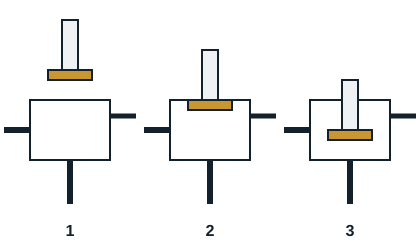

Motor-compressors draw in cold vapour from the evaporator, compress it and discharge it to the condenser, to produce refrigeration.

## Procedure

1. Switch off the whole circuit and lock off.
2. Loosen the cap over the valve stem (HP and BP), then the gland.
3. Make sure the service valve is back-seated (HP and BP).
4. Loosen the gauge port nut on the service valve.
5. Connect the manifold hoses to the gauge ports (blue BP, red HP, yellow vacuum pump).
6. Evacuate the hoses with the pump running; when done, isolate the pump with the manifold valve.
7. With a ratchet spanner, front-seat the HP and BP service valves.
8. Replace the vacuum pump by a recovery unit and recover the refrigerant in the compressor.
9. Disconnect the electrical connections, then remove the suction and discharge valves.
10. Remove the old compressor, test the acidity of its oil and fit the new compressor.
11. Connect the suction and discharge valves, then make the electrical connections.
12. Replace the filter drier.
13. Connect a nitrogen cylinder fitted with a regulator, pressure test at the circuit's PS and check for leaks.
14. Release the nitrogen, connect a vacuum pump and vacuum gauge (vacuomètre), evacuate, break the vacuum, evacuate again and check the vacuum.
15. Remove the pump and gauge, connect the system's refrigerant cylinder.
16. Set the service valves to mid position, start the system, check the pressures and top up the charge.
17. Carry out the leak test (indirect and direct).
18. Back-seat the service valves, remove the hoses, tighten the glands and refit the nuts and caps.
