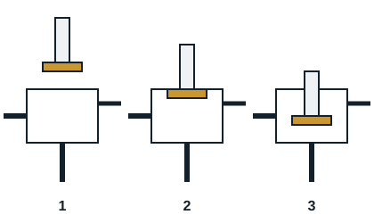

Les moto-compresseurs aspirent les vapeurs froides venant de l'évaporateur, les compriment et les refoulent vers le condenseur, afin d'assurer la production frigorifique.

## Mode opératoire

1. Mettre hors tension tout le circuit et consigner.
2. Desserrer le bouchon qui couvre le carré de manœuvre (HP et BP), puis le presse-étoupe.
3. S'assurer que la vanne de service est en position arrière bloquée (HP et BP).
4. Desserrer l'écrou de prise de pression de la vanne de service.
5. Connecter les flexibles du manifold sur les prises de pression (bleu BP, rouge HP, jaune pompe à vide).
6. Faire le vide dans les flexibles, pompe en marche ; le vide terminé, isoler la pompe par le robinet du manifold.
7. À l'aide d'une clé à cliquet, mettre les vannes de service HP et BP en position avant bloquée.
8. Remplacer la pompe à vide par une station de récupération et récupérer le fluide contenu dans le compresseur.
9. Déconnecter les raccordements électriques, puis démonter les vannes d'aspiration et de refoulement.
10. Enlever l'ancien compresseur, contrôler l'acidité de son huile et poser le nouveau compresseur.
11. Raccorder les vannes d'aspiration et de refoulement, puis effectuer les raccordements électriques.
12. Remplacer le filtre déshydrateur.
13. Raccorder une bouteille d'azote munie d'un manodétendeur, faire le test de pression à la valeur PS du circuit et la recherche de fuite.
14. Vider l'azote, raccorder une pompe à vide et un vacuomètre, tirer au vide, casser le vide, tirer de nouveau et contrôler le vide.
15. Démonter la pompe et le vacuomètre, raccorder la bouteille de fluide de l'installation.
16. Mettre les vannes de service en position intermédiaire, mettre l'installation en marche, contrôler les pressions et faire un complément de charge.
17. Faire le test d'étanchéité (indirect et direct).
18. Mettre les vannes de service en position arrière bloquée, démonter les flexibles, serrer les presse-étoupes et refermer écrous et bouchons.
