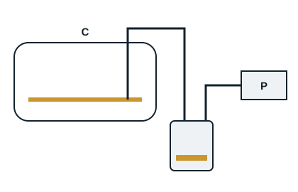

Oil is drained when it is highly acidic and could damage the motor windings, when it is contaminated, or during an overhaul. Used oil is collected in a closed container and handed over as hazardous waste.

For all methods the first part is the same: isolate and lock off the compressor electrically, then isolate it from the rest of the circuit with its valves, or recover all the refrigerant.

| Method | Procedure |
|---|---|
| Syringe | Insert a hose through the filler plug to the bottom of the crankcase and work the syringe; slow, depending on the quantity of oil |
| Vacuum | Insert a hose to the bottom of the crankcase (for example through the oil sight glass), sealed to a container connected to the vacuum pump; the vacuum draws the oil into the container; then refit the sight glass, taking care with the seal |
| Gravity | Possible if the compressor has a drain plug or valve at the bottom of the crankcase: let the oil run into a suitable container, then close |
| Pressure | Compressor with suction and discharge valves: valves front-seated, refrigerant recovered, put the crankcase under light nitrogen pressure (about 0.5 bar, regulator compulsory) through the low-pressure port, and let the oil drain through the drain valve |

After draining: close, evacuate the compressor, draw new oil straight from the can, put the refrigerant back, reconnect the power and restart.

For a compressor with no drain valve or isolating valves, recover the refrigerant, remove the compressor, tip it over and drain the oil through the suction pipe (tuyauterie d'aspiration).
