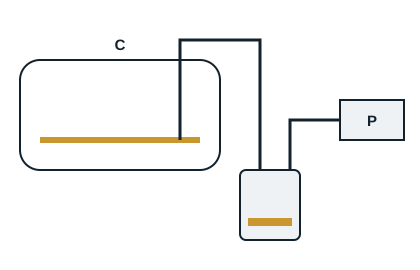

La vidange se fait lorsque l'huile présente un taux d'acidité élevé qui pourrait endommager les enroulements du moteur, lorsque l'huile est contaminée, ou lors d'une rénovation. L'huile usagée est récupérée dans un récipient fermé et confiée à la filière des déchets dangereux.

Pour toutes les méthodes, la première partie de l'opération est la même : isoler et consigner électriquement le compresseur, puis l'isoler du reste du circuit par ses vannes, ou récupérer la totalité du fluide.

| Méthode | Mode opératoire |
|---|---|
| À la seringue | Introduire par le bouchon de remplissage un flexible qui touche le fond du carter et actionner la seringue ; méthode longue selon la quantité d'huile |
| Par dépression | Introduire un flexible au fond du carter (par exemple par le voyant d'huile), raccordé de façon étanche à un récipient lui-même relié à la pompe à vide ; la dépression aspire l'huile dans le récipient ; revisser ensuite le voyant en prenant garde au joint |
| Par gravité | Possible si le compresseur a un bouchon ou une vanne de vidange en partie basse du carter : laisser s'écouler l'huile dans un récipient adapté, puis refermer |
| Sous pression | Compresseur à vannes d'aspiration et de refoulement : vannes fermées sur l'avant, fluide récupéré, mettre le carter sous une légère pression d'azote (0,5 bar environ, manodétendeur obligatoire) par la prise basse pression, et laisser s'écouler l'huile par la vanne de vidange |

Après la vidange : refermer, tirer au vide le compresseur, introduire l'huile neuve par aspiration directement depuis le bidon, réintroduire le fluide, réalimenter et remettre en service.

Pour un compresseur sans vanne de vidange ni vanne d'isolement, on démonte le compresseur après avoir récupéré le fluide, on le renverse et on fait ressortir l'huile par la tuyauterie d'aspiration.
