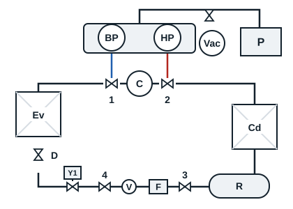
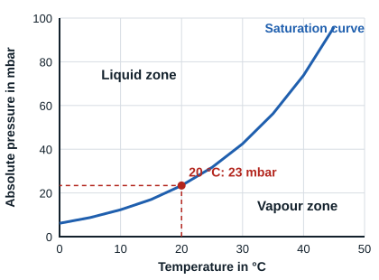

## Diagram references

| Reference | Item |
|---|---|
| BP, HP | Low-pressure and high-pressure gauges of the manifold set |
| Vac | Vacuum gauge and its valve |
| P | Vacuum pump |
| C | Compressor |
| 1, 2 | Suction and discharge service valves |
| Cd, Ev | Condenser, evaporator |
| R | Liquid receiver |
| 3, 4 | Valves upstream and downstream of the filter drier |
| F, V | Filter drier, liquid sight glass |
| Y1 | Liquid solenoid valve |
| D | Expansion valve |

## Evacuation without a vacuum gauge

Without a vacuum gauge the vacuum reached cannot be measured, so this method is only a stopgap. The connections are those of the diagram, without the vacuum gauge.

1. Check the oil level of the vacuum pump, then connect it to the service port of the gauge set.
2. Start the vacuum pump.
3. Set valves 1 and 2 to the mid position and check that the circuit is not under pressure.
4. Open the bypass valves of the manifold set and check that the pressure falls on the needles of the HP and BP gauges.
5. Open valves 3 and 4. After a while, close the bypass valves of the manifold set and check the vacuum hold.
6. Break the vacuum with dry nitrogen if possible (see the next section), then resume the evacuation.
7. A needle at -1 bar only shows that the circuit is approaching vacuum: a pressure gauge scale is too coarse to judge it. Extend the evacuation according to the volume of the circuit and check with a vacuum gauge as soon as possible.
8. Close the HP and BP bypass valves of the manifold set, then stop the vacuum pump.
9. Charge the system immediately.

## Evacuation with a vacuum gauge

### How low should the pressure go?

The pressure-temperature curve of water gives the pressure below which water vaporises at the temperature of the circuit. At 20 °C, water vaporises below about 23 mbar absolute.

That pressure is a threshold to go well below. The practical target is **1 mbar absolute or less**, unless the compressor manufacturer gives another value. Set this value on the vacuum gauge with the reference needle.

### Procedure

1. Connect the vacuum pump after checking its oil level, and start it.
2. Set valves 1 and 2 to the mid position and check that the circuit is not under pressure.
3. Open the bypass valves of the manifold set and the valve of the vacuum gauge. The pressure must start to fall on the needles of the HP and BP gauges.
4. Open valves 3 and 4. After a while, close the bypass valves of the manifold set and check the vacuum hold on the vacuum gauge:
   - the pressure rises a little then settles: moisture remains, continue the evacuation;
   - the pressure keeps rising: there is a leak, find it before continuing.
5. Break the vacuum with dry nitrogen if possible, remembering to close the valve of the vacuum gauge during the operation (see the next section).
6. The evacuation is finished when the needle of the vacuum gauge is below the reference needle.
7. At that point, close the HP and BP bypass valves of the manifold set and the valve of the vacuum gauge, then stop the vacuum pump.
8. Charge the system immediately.

[[figure:manifold-vide]]
