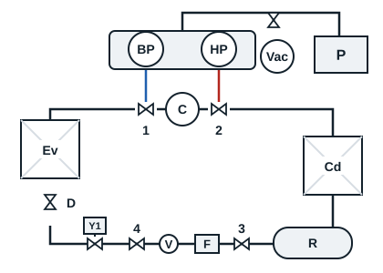
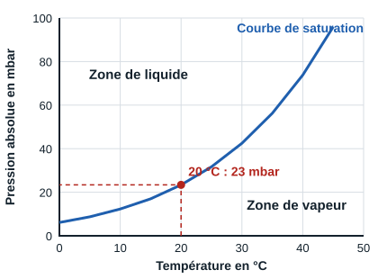

## Repères du schéma

| Repère | Élément |
|---|---|
| BP, HP | Manomètres basse et haute pression du jeu de manifolds |
| Vac | Vacuomètre et sa vanne |
| P | Pompe à vide |
| C | Compresseur |
| 1, 2 | Vannes de service aspiration et refoulement |
| Cd, Ev | Condenseur, évaporateur |
| R | Bouteille de liquide |
| 3, 4 | Vannes en amont et en aval du déshydrateur |
| F, V | Déshydrateur, voyant liquide |
| Y1 | Électrovanne liquide |
| D | Détendeur |

## Tirage au vide sans vacuomètre

Sans vacuomètre, le vide atteint ne peut pas être mesuré : ce tirage reste une solution de dépannage. Le raccordement est celui du schéma, sans le vacuomètre.

1. Vérifier le niveau d'huile de la pompe à vide, puis la raccorder sur la voie d'intervention du jeu de manomètres.
2. Démarrer la pompe à vide.
3. Mettre les vannes 1 et 2 en position intermédiaire et vérifier que le circuit n'est pas sous pression.
4. Ouvrir les bypass du jeu de manifolds et vérifier que la pression diminue sur les aiguilles des manomètres HP et BP.
5. Ouvrir les vannes 3 et 4. Au bout d'un moment, refermer les bypass du jeu de manifolds et vérifier la tenue du vide.
6. Casser le vide à l'azote sec si possible (voir la section suivante), puis reprendre le tirage.
7. Une aiguille à -1 bar montre seulement que le circuit approche du vide : l'échelle d'un manomètre est trop grossière pour en juger. Prolonger le tirage selon le volume du circuit et contrôler au vacuomètre dès que possible.
8. Refermer les bypass HP et BP du jeu de manifolds, puis arrêter la pompe à vide.
9. Réaliser immédiatement la charge du système.

## Tirage au vide avec vacuomètre

### Jusqu'à quelle pression tirer ?

La courbe de relation pression-température de l'eau indique la pression sous laquelle l'eau se vaporise à la température du circuit. À 20 °C, l'eau se vaporise sous 23 mbar absolus environ.

Cette pression est un seuil à franchir largement. La valeur à viser en pratique est de **1 mbar absolu ou moins**, sauf valeur différente donnée par le fabricant du compresseur. Indiquer cette valeur sur le vacuomètre à l'aide de l'aiguille repère.

### Mode opératoire

1. Brancher la pompe à vide après avoir vérifié son niveau d'huile, et la démarrer.
2. Mettre les vannes 1 et 2 en position intermédiaire et vérifier que le circuit n'est pas sous pression.
3. Ouvrir les bypass du jeu de manifolds ainsi que la vanne du vacuomètre. La pression doit commencer à diminuer sur les aiguilles des manomètres HP et BP.
4. Ouvrir les vannes 3 et 4. Au bout d'un moment, refermer les bypass du jeu de manifolds et vérifier la tenue du vide sur le vacuomètre :
   - la pression monte un peu puis se stabilise : il reste de l'humidité, poursuivre le tirage ;
   - la pression monte sans s'arrêter : il y a une fuite, la rechercher avant de continuer.
5. Casser le vide à l'azote sec si possible, en pensant à refermer le robinet du vacuomètre pendant l'opération (voir la section suivante).
6. Le tirage est terminé quand l'aiguille du vacuomètre est sous celle de repère.
7. À ce moment-là, refermer les bypass HP et BP du jeu de manifolds ainsi que la vanne du vacuomètre, puis arrêter la pompe à vide.
8. Réaliser immédiatement la charge du système.

[[figure:manifold-vide]]
