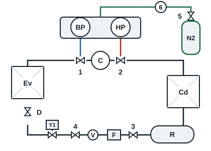

Dry nitrogen let into the evacuated circuit takes up the remaining moisture and carries it away as it escapes. The next evacuation is faster and more complete.

References 5 and 6: nitrogen cylinder valve and pressure regulator (manodétendeur). A nitrogen cylinder is never connected without a regulator.

1. Close the bypass valves of the manifold set to isolate the pump, then stop the pump. Close the valve of the vacuum gauge.
2. Connect the hose to the outlet of regulator 6.
3. Back off the regulator screw, open valve 5, then set the regulator to about 1 bar.
4. Reopen the bypass valves of the manifold set to let the nitrogen in, up to about 0.5 bar on the needles of the HP and BP gauges.
5. Close the bypass valves, close valve 5 and disconnect the nitrogen cylinder.
6. Let the nitrogen escape from the system down to atmospheric pressure (0 bar on the gauges).
7. Reconnect the vacuum pump and restart it to continue the evacuation. Never connect the pump to a circuit that is still under pressure.
