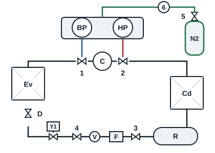

L'azote sec, introduit dans le circuit au vide, se charge de l'humidité restante et l'emporte quand il s'échappe. Le tirage suivant est plus rapide et plus complet.

Repères 5 et 6 : robinet de la bouteille d'azote et manodétendeur. Une bouteille d'azote ne se raccorde jamais sans manodétendeur.

1. Refermer les bypass du jeu de manifolds pour isoler la pompe à vide, puis arrêter la pompe. Refermer le robinet du vacuomètre.
2. Raccorder le flexible sur le raccord du manodétendeur 6.
3. Desserrer la vis du manodétendeur, ouvrir le robinet 5, puis régler le manodétendeur à 1 bar environ.
4. Réouvrir les bypass du jeu de manifolds pour introduire l'azote, jusqu'à 0,5 bar environ sur les aiguilles des manomètres HP et BP.
5. Refermer les bypass, refermer le robinet 5 et débrancher la bouteille d'azote.
6. Laisser l'azote s'échapper de l'installation jusqu'à la pression atmosphérique (0 bar sur les manomètres).
7. Rebrancher la pompe à vide et la redémarrer pour continuer le tirage au vide. Ne jamais raccorder la pompe sur un circuit encore sous pression.
