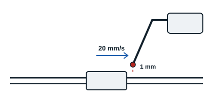

Some methods measure the leak, others only show that a threshold is exceeded.

| Method | Principle | Key points |
|---|---|---|
| Measuring detector | A probe connected to the detector is moved slowly along the points to check on the pressurised circuit (mass spectrometer, flame ionisation unit) | Gives the leak value, down to a few tenths of g/year or a few ppmv; probe right at the leak, at 20 mm/s at most and 1 mm away; calibrate on a calibrated leak |
| Electronic detector | Detects and locates, signalling when a threshold is exceeded (LEDs, beep) | The most used; sensitivity at least 5 g/year, usually from 1 g/year; probe at 20 mm/s at most and 1 mm away; check the threshold on a calibrated leak |
| Leak detection foam | Surfactant liquid sprayed on the pressurised circuit: a leak forms bubbles | More sensitive and repeatable than soapy water; spray sparingly from 10 to 20 cm; check compatibility with materials |
| Soapy water | Brushed or sprayed on the pressurised circuit: a leak forms foam | Simple, for sizeable leaks |
| Fluorescent dye | Tracer added to the running circuit, then searched with an ultraviolet lamp | Gloves, safety glasses and UV glasses |

Surfactants lower the liquid's surface tension (tension superficielle): leaking gas then forms visible bubbles more easily.

**Conclusion**: for leak testing, the most practical methods are nitrogen pressurisation, pressure rise and, for small systems, the gauge check. To locate leaks: electronic detectors (most sensitive), measuring detectors (give a value, sensitive but costly) and foam (simple, good for sizeable leaks).
