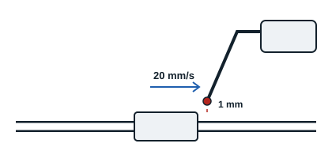

Certaines méthodes mesurent la fuite, d'autres indiquent seulement le dépassement d'un seuil.

| Méthode | Principe | Points clés |
|---|---|---|
| Détecteur-mesureur | Une sonde reliée au détecteur est déplacée lentement le long des points à contrôler sur le circuit pressurisé (spectromètre de masse, appareil à ionisation de flamme) | Indique la valeur de la fuite, jusqu'à quelques dixièmes de g/an ou quelques ppmv ; sonde au droit de la fuite, à 20 mm/s au plus et 1 mm de distance ; étalonner sur une fuite calibrée |
| Détecteur électronique | Détection et localisation avec indication de dépassement d'un seuil (diodes, bip sonore) | Les plus utilisés ; sensibilité au moins égale à 5 g/an, détectent en général à partir de 1 g/an ; sonde à 20 mm/s au plus et 1 mm de distance ; vérifier le seuil sur une fuite calibrée |
| Produit moussant de détection | Liquide à tensio-actifs pulvérisé sur le circuit pressurisé : la fuite forme des bulles | Plus sensible et plus reproductible que l'eau savonneuse ; pulvériser sans excès à 10 à 20 cm ; vérifier la compatibilité avec les matériaux |
| Eau savonneuse | Appliquée au pinceau ou pulvérisée sur le circuit pressurisé : la fuite forme de la mousse | Simple, pour les fuites non négligeables |
| Fluide fluorescent | Traceur introduit dans le circuit en fonctionnement, puis recherche à la lampe ultraviolette | Gants, lunettes de protection et lunettes anti-UV |

Les tensio-actifs abaissent la tension superficielle du liquide : le gaz qui fuit forme alors plus facilement des bulles visibles.

**Conclusion** : pour le contrôle de l'étanchéité, les méthodes les plus pratiques sont la mise sous pression d'azote, la remontée de pression et, pour les installations de faible volume, le contrôle au manomètre. Pour localiser les fuites : les détecteurs électroniques (plus sensibles), le détecteur-mesureur (qui donne une mesure, sensible mais onéreux) et le produit moussant (simple, bon pour les fuites non négligeables).
