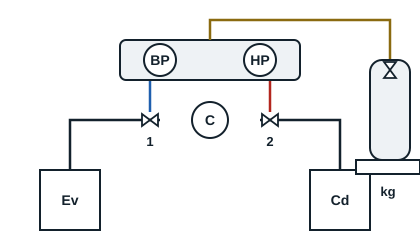

## Liquid charging

With a dip-tube cylinder standing upright, liquid is drawn off. This gives a fast charge, sending liquid into the liquid part of the circuit, at the condenser outlet, with the compressor stopped. Chillers, chilled-water systems, are charged with liquid after starting the circulating pumps, to stop the evaporator freezing.

**Procedure**

1. Switch off the system.
2. With evacuation and vacuum check done, disconnect the vacuum pump and gauge, then connect the refrigerant cylinder.
3. Stand the cylinder on electronic scales and zero them.
4. Pre-charge with liquid into the liquid line, compressor stopped.
5. Start the system and complete the charge while watching the HP and BP pressures and the mass added; topping up with liquid on the BP side is done only in small amounts, so no liquid reaches the compressor.
6. When charging is finished, isolate the cylinder.
7. Back-seat the service valve, remove the hoses and refit the nuts.

## Vapour charging

This method is slower but protects the compressor. Charging is done through the compressor BP, with the dip-tube cylinder turned upside down to draw off vapour. It only suits single-component refrigerants and azeotropic blends.

**Procedure**

1. Switch off the circuit.
2. With evacuation and its check done, disconnect the vacuum pump and gauge.
3. Connect the refrigerant cylinder, turn it upside down, stand it on the scales and zero them.
4. Open the cylinder and pre-charge.
5. Start the system.
6. Charge gradually through the BP valves, watching the HP and BP pressures and the scales, up to the exact mass.
7. When finished, isolate the cylinder, back-seat the BP service valve, remove the hoses and refit the nuts.

[[figure:manifold-charge]]
