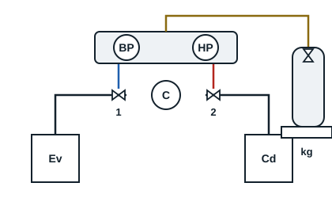

## Charge en phase liquide

Avec une bouteille à tube plongeur posée debout, on soutire du liquide. Cette méthode permet une charge rapide, en envoyant le liquide dans la zone liquide du circuit, à la sortie du condenseur, compresseur à l'arrêt. Les chillers, systèmes à eau glacée, se chargent en phase liquide après avoir mis en marche les circulateurs, pour éviter que l'évaporateur ne gèle.

**Mode opératoire**

1. Mettre l'installation hors tension.
2. Le vide et le contrôle du vide faits, déconnecter la pompe à vide et le vacuomètre, puis connecter la bouteille de fluide.
3. Poser la bouteille sur une balance électronique et faire le zéro.
4. Faire une pré-charge en liquide dans la ligne liquide, compresseur à l'arrêt.
5. Mettre l'installation en marche et compléter la charge en contrôlant les pressions HP et BP et la masse introduite ; un complément en liquide côté BP se fait seulement par petites quantités, pour ne pas envoyer de liquide au compresseur.
6. La charge terminée, isoler la bouteille.
7. Mettre la vanne de service en position arrière bloquée, démonter les flexibles et fermer les écrous.

## Charge en phase vapeur

Cette méthode met plus de temps, mais elle protège le compresseur. La charge se fait par la BP du compresseur, la bouteille à tube plongeur retournée pour soutirer de la vapeur. Elle ne convient qu'aux fluides purs et aux mélanges azéotropes.

**Mode opératoire**

1. Mettre le circuit hors tension.
2. Le vide et son contrôle faits, déconnecter la pompe à vide et le vacuomètre.
3. Raccorder la bouteille de fluide, la retourner, la poser sur la balance et faire le zéro.
4. Ouvrir la bouteille et faire une pré-charge.
5. Mettre l'installation en marche.
6. Charger progressivement par les robinets BP, en contrôlant les pressions HP et BP et la balance, jusqu'à la masse exacte.
7. La charge terminée, isoler la bouteille, mettre la vanne de service BP en position arrière bloquée, démonter les flexibles et fermer les écrous.

[[figure:manifold-charge]]
