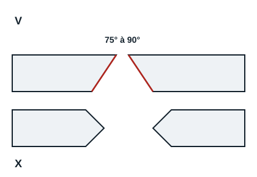
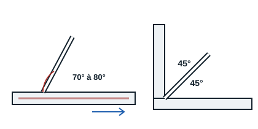

## Preparation

Before welding, degrease the surface, or grind it back to bare metal (a painted surface, for example). On thick parts, bevel the edges: a V preparation between 4 and 15 mm thick, an X preparation above that.

## Tacking

As it cools after welding, metal shrinks, which can distort the assembly (angular distortion). To avoid this, the assembly is first tacked (pointage): spot welds are made at different places as quickly as possible, so the earlier ones have no time to cool and shrink. Once tacked, check the assembly (spacing, squareness). If it is right, go on to the beads; if not, grind off the tacks and start again.

## Electrode position

Electrode handling covers the angles of tilt, the travel speed along the bead, the weaving motion across the bead and the feed of the electrode as it melts, which keeps a constant arc length of about the electrode diameter.

The welder makes the bead by drawing the electrode towards himself or herself. The electrode is at 70° to 80° to the weld plane: a larger angle traps slag; a smaller one no longer points the arc at the metal, the pool is shallow and spatter heavy. For a fillet weld the electrode is at 45° to both parts; if one part is thicker, the arc is directed more towards it.

