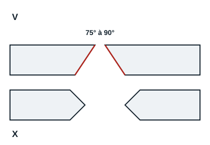
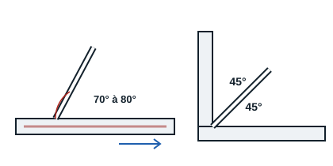

## Préparation

Avant de souder, dégraisser la surface, voire la meuler jusqu'au métal apparent (surface peinte par exemple). Sur une forte épaisseur, chanfreiner les pièces : en V entre 4 et 15 mm d'épaisseur, en X au-delà.

## Le pointage

En refroidissant après une soudure, le métal se rétracte, ce qui peut déformer l'assemblage (déformation angulaire). Pour l'éviter, on pointe d'abord l'assemblage : on fait des points de soudure à différents endroits, le plus rapidement possible, pour que les points précédents n'aient pas le temps de refroidir et de se rétracter. Une fois le pointage terminé, on contrôle l'assemblage (distance, perpendicularité). Si la vérification est satisfaisante, on passe aux cordons ; sinon, on fait sauter les points à la meuleuse et on recommence.

## Position de l'électrode

La manipulation de l'électrode se définit par les angles d'inclinaison, la vitesse d'avancement dans le sens du cordon, le mouvement oscillant autour du cordon et la vitesse d'avancement de l'électrode au fur et à mesure de sa fusion, qui garde un arc de longueur constante, environ égale au diamètre de l'électrode.

Le soudeur fait son cordon en tirant l'électrode vers lui. L'électrode forme un angle de 70° à 80° avec le plan de la soudure : un angle plus grand provoque des inclusions de laitier ; un angle plus petit n'oriente plus l'arc vers le métal, le bain est superficiel et les projections nombreuses. Pour une soudure en angle, l'électrode est à 45° des deux pièces ; si une pièce est plus épaisse, on dirige davantage l'arc vers elle.

