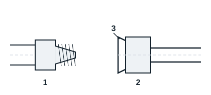

## General points

Fittings join items of a system (valve, hoses, pipework...) by heat (welding, brazing) or mechanically (screwed). Each fitting comes in almost every diameter and various shapes (elbow, tee, offset, coupling...), with many options (equal, reduced, male/male, female/female, male/female, 45°, 90°). They may be made of copper, steel, brass, aluminium, etc.

Fittings are brazed, crimped, screwed, or flameless press-fit.

## Copper brazed fittings

| Fitting | Feature |
|---|---|
| Y connector | Two paths, identical or different |
| Elbow | Changes the direction of the tube |
| Three-way T connector | Identical or different path |
| U connector | 180° return |

## Screwed fitting (flare)

The copper tube is flared. A nut presses the conical end against a threaded cone. The seal comes from tightening these two conical parts together.

References: 1 half-union, 2 nut, 3 flared surface of the tube. Align the centres before tightening. When flaring (évasement), leave 2 to 3 mm of tube above the jaw of the flaring tool.

## Brass screwed fittings

| Fitting | Sizes | Type |
|---|---|---|
| Screwed nut | 1/4 | Female |
| Screwed elbow, 90° | 1/4 and 1/8 | Male, male conical |
| Screwed elbow, 135° | 1/4 | Male, male |
| Screwed union | 3/8 | Male, male conical |
| Screwed tee | 1/4 | Male, female, male |
| Screwed and brazed union | 1/2 | Male, male |
| Cylinder charging adaptor | 1/4 and 18/150 | Male, female |

There are also flare nuts, flare sealing caps, flare gauges, crosses, refrigerant cylinder adaptors, union screws and flare elbows.

The nominal diameter of flare fittings is given by the bore of the male flare fitting.

| Nominal diameter | Bore (mm) | Outside thread diameter (mm) |
|---|---|---|
| 1/8 C | 3.17 | 10.3 |
| 1/4 C | 6.35 | 13.7 |
| 3/8 C | 9.52 | 17.1 |
| 1/2 C | 12.7 | 21.3 |
