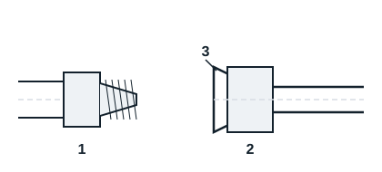

## Généralités

Les raccords permettent d'assembler, par moyen thermique (soudure, brasure) ou mécanique (à visser), différents éléments d'installation (vanne, flexibles, tuyauteries...). Chaque raccord peut être trouvé dans quasiment tous les diamètres et différentes formes (coude, té, pied de biche, manchon...), avec une multitude de possibilités (égal, réduit, mâle/mâle, femelle/femelle, mâle/femelle, à 45°, à 90°). Ces raccords peuvent être en cuivre, en acier, en laiton, en aluminium, etc.

On distingue les raccords à souder, à sertir, à visser et les raccords à sertir sans flamme.

## Raccords en cuivre à souder

| Raccord | Particularité |
|---|---|
| Connecteur en Y | Deux chemins, identiques ou différents |
| Coude | Change la direction du tube |
| Connecteur 3 voies en T | Chemin identique ou différent |
| Connecteur en U | Retour à 180° |

## Raccord à visser (dudgeon)

Le tube de cuivre est évasé. Un écrou plaque la partie conique ainsi créée sur un cône fileté. L'étanchéité est réalisée à partir du serrage de ces deux parties coniques.

Repères : 1 demi-raccord, 2 écrou, 3 surface évasée du tube. Faire correspondre les centres avant de serrer. Lors d'un évasement conique, la distance de tube qu'on laisse au-dessus du mors de la dudgeonnière est de 2 à 3 mm.

## Raccords en laiton à visser

| Raccord | Dimensions | Type |
|---|---|---|
| Écrou à visser | 1/4 | Femelle |
| Coude à visser, 90° | 1/4 et 1/8 | Mâle, mâle conique |
| Coude à visser, 135° | 1/4 | Mâle, mâle |
| Raccord à visser | 3/8 | Mâle, mâle conique |
| Té à visser | 1/4 | Mâle, femelle, mâle |
| Raccord à visser et à souder | 1/2 | Mâle, mâle |
| Raccord de charge pour bouteille | 1/4 et 18/150 | Mâle, femelle |

On trouve aussi l'écrou conique, le capuchon d'étanchéité conique, la jauge évasée, la croix, l'adaptateur pour cylindre de réfrigérant, la vis union et le coude conique.

Le diamètre nominal des raccords coniques est donné par le diamètre de perçage du raccord conique mâle.

| Diamètre nominal | Diamètre de perçage (mm) | Diamètre extérieur du filetage (mm) |
|---|---|---|
| 1/8 C | 3,17 | 10,3 |
| 1/4 C | 6,35 | 13,7 |
| 3/8 C | 9,52 | 17,1 |
| 1/2 C | 12,7 | 21,3 |
