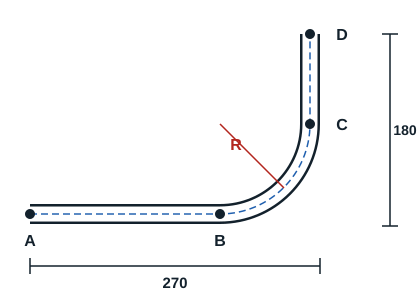

Pipework lets the fitter make connections that carry all kinds of fluid. The fitter must therefore be able to carry out the various operations on pipework to obtain good distribution of the fluid, without losses.

To obtain the developed length (total length) of a tube, identify the straight and curved parts of the bend. The sum of the two gives the length of tube to use.

The drawing has two dimensions, 270 mm and 180 mm, each including a straight length and a bend radius. The bend radius (rayon de cintrage) is always given by the bender.

| Diameter (inch) | Diameter (mm) | Wall (mm) | Bend form | Bend radius (mm) |
|---|---|---|---|---|
| 3/8" | 17.2 | 2 | 12/17 | 46.5 |
| 1/2" | 21.3 | 2.3 | 15/21 | 55.5 |
| 3/4" | 26.9 | 2.3 | 20/27 | 71 |
| 1" | 33.7 | 2.9 | 26/34 | 94 |
| 1 1/4" | 42.4 | 2.9 | 33/42 | 150 |
| 1 1/2" | 48.3 | 2.9 | 40/49 | 163 |
| 2" | 60.3 | 3.2 | 50/60 | 220 |

This table applies to steel tube: its designation in inches differs from copper's (3/4" is 19.05 mm in copper, 26.9 mm here). Example with 3/4" tube, so R = 71 mm.

**1. Straight lengths.**

- AB = 270 - 71 = 199 mm
- CD = 180 - 71 = 109 mm

**2. Curved part.** It is a quarter of the circumference 2 × π × R.

- For 90°: L = π × R / 2, that is 2 × 3.14 × 71 / 4 = 111.47 mm
- For any angle α: L = 2 × π × R × α / 360

**3. Developed length.** LD = sum of straight parts + sum of curved parts.

LD = 199 + 109 + 111.47 = 419.47 mm

During bending, one part of the tube is neither compressed nor stretched: the neutral fibre. It separates the stretched fibre, on the outside of the bend, from the compressed fibre on the inside.
