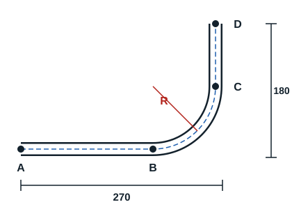

La tuyauterie permet au frigoriste d'effectuer des liaisons destinées à faire circuler tous types de fluide. Il doit donc être apte à réaliser les différentes manipulations sur une tuyauterie pour obtenir une bonne distribution de fluide, sans pertes.

Pour obtenir la longueur développée (longueur totale) d'un tube, il faut identifier les parties droites et les parties courbes du cintrage. La somme des deux donne la longueur de tube à utiliser.

Le schéma comporte deux cotes, 270 mm et 180 mm, qui comprennent chacune une longueur droite et un rayon de cintrage. Le rayon de cintrage est toujours donné par la cintreuse.

| Diamètre (pouce) | Diamètre (mm) | Épaisseur (mm) | Forme de cintrage | Rayon de cintrage (mm) |
|---|---|---|---|---|
| 3/8" | 17,2 | 2 | 12/17 | 46,5 |
| 1/2" | 21,3 | 2,3 | 15/21 | 55,5 |
| 3/4" | 26,9 | 2,3 | 20/27 | 71 |
| 1" | 33,7 | 2,9 | 26/34 | 94 |
| 1 1/4" | 42,4 | 2,9 | 33/42 | 150 |
| 1 1/2" | 48,3 | 2,9 | 40/49 | 163 |
| 2" | 60,3 | 3,2 | 50/60 | 220 |

Ce tableau vaut pour les tubes en acier : leur désignation en pouces n'est pas la même que celle du cuivre (3/4" vaut 19,05 mm en cuivre, 26,9 mm ici). Exemple avec le tube 3/4", donc R = 71 mm.

**1. Longueurs droites.**

- AB = 270 - 71 = 199 mm
- CD = 180 - 71 = 109 mm

**2. Partie courbe.** Elle correspond à un quart du périmètre du cercle 2 × π × R.

- Pour 90° : L = π × R / 2, soit 2 × 3,14 × 71 / 4 = 111,47 mm
- Pour un angle α quelconque : L = 2 × π × R × α / 360

**3. Longueur développée.** LD = somme des parties droites + somme des parties courbes.

LD = 199 + 109 + 111,47 = 419,47 mm

Lors du cintrage, une partie du tube n'est ni comprimée ni tendue : c'est la fibre neutre. Elle sépare la fibre tendue, à l'extérieur du coude, de la fibre comprimée, à l'intérieur.
