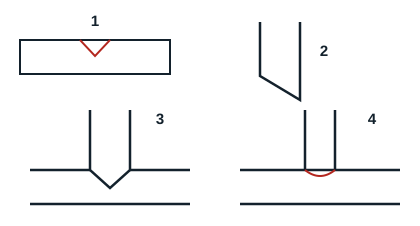

## Measuring, cutting, deburring and fixing

1. **Measuring** means marking the required dimension before cutting the tube, with a tape measure.
2. **Cutting** is done with a tube cutter. Place the pipe between the cutter's sliding rollers, lock the tube with the adjustable handle, apply slight pressure and make one complete turn. Tighten a little more, turn again, and continue until the pipe is cut.
3. **Deburring** means cleaning the cut tube. Hold the tube vertically, end pointing down, and trim off the residue from the cut with a deburrer. A poorly deburred pipe leaves swarf that ends up in the circuit and causes faults.
4. **Fixing** means holding a tube in a suitable, final position, with clips or trunking.

## Bevelling and branching

- **Bevelling** (biseautage) is an angled cut in a pipe to make branches on pipes of the same diameter.
- **Branching** (piquage) is a round cut. It is done when no tee is available or to branch onto a pipe of a different diameter.
