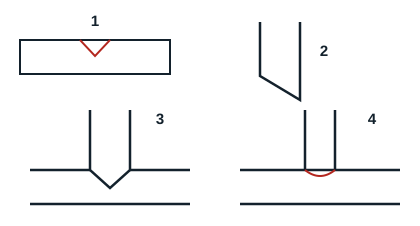

## Mesure, coupe, ébavurage et fixation

1. **La mesure** consiste à marquer la dimension dont on a besoin avant d'effectuer la coupe du tube. Elle s'effectue à l'aide d'un mètre.
2. **La coupe** s'effectue à l'aide d'un coupe-tube. Placer la tuyauterie entre les cylindres coulissants du coupe-tube, bloquer le tube avec la manette réglable, exercer une légère pression et faire un tour complet. Serrer encore légèrement, puis refaire un tour, et continuer jusqu'à couper la tuyauterie.
3. **L'ébavurage** consiste à nettoyer le tube coupé. Placer le tube verticalement, extrémité vers le bas, et à l'aide d'un ébavureur, tailler les résidus laissés par la coupe. Une tuyauterie mal ébavurée laisse des déchets qui vont se retrouver dans le circuit et former des anomalies.
4. **La fixation** consiste à immobiliser un tube dans une position convenable et définitive. Elle se fait à l'aide de colliers ou de goulottes.

## Biseautage et piquage

- **Le biseautage** est une entaille en forme de biais qu'on effectue sur une tuyauterie pour réaliser des dérivations sur des tuyauteries de même diamètre.
- **Le piquage** est une entaille en forme de rond. Il s'effectue quand on ne possède pas de té ou quand on veut faire une dérivation sur une tuyauterie dont les diamètres ne sont pas identiques.
