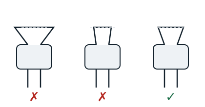

## Conical flaring

This means forming a conical collar on a tube, having first slipped a nut onto it. It is done with a flaring tool and makes refrigeration connections without brazing.

**Procedure**: place the tube in the flaring tool in the matching size, leaving 2 to 3 mm above the clamp. Seat the tube carefully, position the flaring cone and screw it down slowly. Take out the tube and inspect the flare. If it is good, make sure it fits exactly inside the nut; otherwise cut it off and start again.

## Swaging

Swaging (emboutissage) is done to join two tubes of the same diameter on a refrigeration line, with a swaging tool.

**Method**: fit the die of the matching size on the tool, place the tube in the die and close the tool gently so as not to tear the tube. The joint is then brazed.
