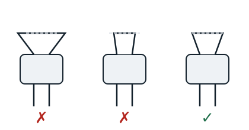

## L'évasement conique : le dudgeonnage

Il consiste à réaliser un collet conique sur un tube, ayant au préalable monté un écrou sur celui-ci. Il s'effectue avec une dudgeonnière et sert à réaliser des liaisons frigorifiques sans soudure.

**Mode opératoire** : placer le tube dans la dudgeonnière sur le diamètre correspondant, en laissant 2 à 3 mm au-dessus du socle de serrage. Lentement, bien coucher le tube dans son socle, positionner la touche à dudgeonner puis visser. Sortir le tube et examiner la partie dudgeonnée. Si elle est bonne, s'assurer qu'elle s'adapte exactement à l'intérieur de l'écrou, sinon il faut couper et recommencer.

## L'évasement cylindrique : l'emboutissage

Il se fait lorsqu'on veut réunir deux tubes de même diamètre sur une liaison frigorifique. Il se réalise à l'aide d'une pince à emboutir.

**Réalisation** : fixer le cylindre du diamètre correspondant sur la pince, placer le tube à emboutir dans le cylindre et fermer légèrement la pince pour ne pas déchirer le tube. La liaison s'effectue ensuite par brasage.
