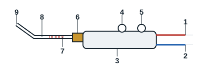
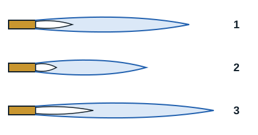

## Mixing torch

Torches mix fuel gas and oxygen in the right proportions, to burn them at the tip of the welding or heating nozzle.

In the injection system, the oxygen supply pressure is much higher than that of the fuel gas. In the injector, the oxygen pressure turns into velocity. This creates a depression at the injector outlet that draws in the fuel gas. The mixing tube then gives a uniform mixture of both gases. The flammable mixture can then be lit at the end of the nozzle.

The injector, mixing base, mixing tube and nozzle form one unit called the torch shank, replaced as a whole according to the heat needed.

| Reference | Item |
|---|---|
| 1 | Fuel gas hose connection |
| 2 | Oxygen hose connection |
| 3 | Handle |
| 4 | Fuel gas valve |
| 5 | Oxygen valve |
| 6 | Hand-tightened coupling nut |
| 7 | Injector |
| 8 | Mixing tube |
| 9 | Welding (heating) nozzle |

## Flame adjustment

First select the nozzle for the type of metal to be welded. Then:

1. Open the acetylene valve and light it. The flame lifts off the nozzle because the acetylene flow is too high.
2. Reduce the acetylene until the flame comes back to the nozzle.
3. Adjust the oxygen until the desired flame is obtained.

The oxygen regulator is set between 0.5 and 1.5 bar. The acetylene regulator is set between 0.2 and 0.5 bar.

| Reference | Flame | Appearance |
|---|---|---|
| 1 | Neutral | The flame normally used for welding. The inner cone (dard) is brilliant white and very sharp at the nozzle |
| 2 | Oxidising | Excess oxygen: envelope and cone are shortened, the flame hisses |
| 3 | Carburising | Excess acetylene: envelope and cone are lengthened, with irregular shapes |

The flame reaches about 3100 °C at the tip of the inner cone.

[[figure:flamme]]
