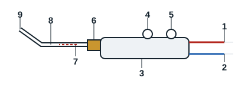
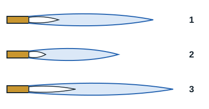

## Chalumeau mélangeur

Les chalumeaux sont conçus pour mélanger les gaz combustibles et l'oxygène dans les proportions adéquates, pour les brûler à l'extrémité de la buse de soudage ou de chauffage.

Le système d'injection se caractérise par une pression d'alimentation de l'oxygène nettement plus élevée que celle du gaz combustible. Dans l'injecteur, la pression de l'oxygène est transformée en vitesse. Il en résulte une dépression à la sortie de l'injecteur qui aspire le gaz combustible. Le tube mélangeur assure ensuite un mélange homogène des deux gaz. Le mélange inflammable peut alors être allumé à l'extrémité de la buse.

L'injecteur, la base de mélange, le tube de mélange et la buse forment un tout appelé lance du chalumeau, à remplacer entièrement selon la chaleur nécessaire.

| Repère | Élément |
|---|---|
| 1 | Raccord du tuyau de gaz combustible |
| 2 | Raccord du tuyau d'oxygène |
| 3 | Manche |
| 4 | Robinet de gaz combustible |
| 5 | Robinet d'oxygène |
| 6 | Écrou d'accouplement à serrage manuel |
| 7 | Injecteur |
| 8 | Tube de mélange |
| 9 | Buse de soudage (de chauffage) |

## Réglage de la flamme

Il faut d'abord sélectionner la buse correspondant au type de métal à souder. Ensuite :

1. Ouvrir le robinet d'acétylène et l'enflammer. La flamme qui jaillit est décollée de la buse à cause d'un débit d'acétylène trop important.
2. Réduire l'acétylène jusqu'à ce que la flamme recolle à la buse.
3. Régler l'oxygène jusqu'à obtenir la flamme souhaitée.

La plage de réglage sur le manodétendeur d'oxygène est comprise entre 0,5 et 1,5 bar. Celle du manodétendeur d'acétylène est comprise entre 0,2 et 0,5 bar.

| Repère | Flamme | Aspect |
|---|---|---|
| 1 | Neutre ou normale | La flamme normalement utilisée pour le soudage. Le dard est de couleur blanc brillant et de forme très nette en sortie de buse |
| 2 | Oxydante | Excès d'oxygène : le panache et le dard sont raccourcis, la flamme émet un sifflement |
| 3 | Carburante | Excès d'acétylène : le panache et le dard sont allongés, avec des formes irrégulières |

La température de la flamme atteint environ 3100 °C à la pointe du dard.

[[figure:flamme]]
