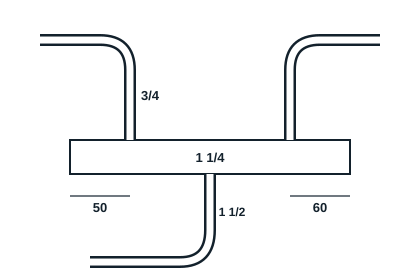
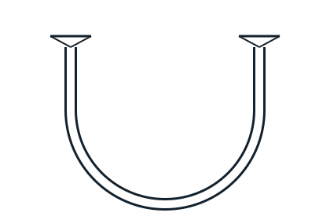

## Equipment and tools (per workstation)

- 1 oxy-acetylene set
- Copper tube 3/4 and 1 1/4, annealed copper tube 1/2
- 1 tube cutter, 1 deburrer, 1 swaging tool, 1 tube bender
- Filler rods and flux
- Tinted goggles, gloves, extinguisher

## Sequence of work (12 h)

Model 1, suction header: two 3/4 copper branches on a 1 1/4 header, conical outlet.

Model 2, oil trap (siphon): two tubes joined by a U-bent trap, inlet and outlet at the same height.

1. Trainer demonstrates brazing.
2. Prepare the tubes: cutting, deburring, bending, swaging.
3. Clean and coat with flux.
4. Braze model 1, then model 2.
5. Remove flux residue.
6. Assessment.

## Assessment

- Accuracy of position and soundness of joints: 15%
- Operation (complete, tight joints): 60%
- Standards, choice of equipment and safety: 10%
- Work report: 15%
