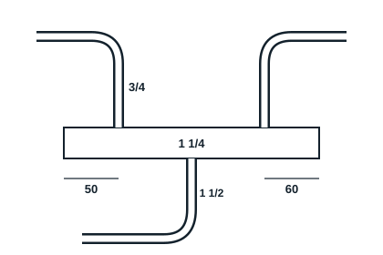
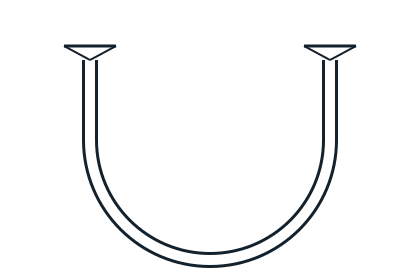

## Matériel et outillage nécessaires (par poste de travail)

- 01 poste oxyacétylénique
- Tube de cuivre 3/4 et 1 1/4, tube de cuivre recuit 1/2
- 01 coupe-tube, 01 ébavureur, 01 pince à emboutir, 01 cintreuse
- Baguettes de brasure et décapant
- Lunettes teintées, gants, extincteur

## Séquence de réalisation (12 h)

Maquette 1, collecteur d'aspiration : deux piquages en cuivre 3/4 sur un collecteur 1 1/4, sortie en col conique.

Maquette 2, siphon : deux tubes reliés par un siphon cintré en U, entrée et sortie à la même hauteur.

1. Démonstration du brasage par le formateur.
2. Préparer les tubes : coupe, ébavurage, cintrage, emboutissage.
3. Nettoyer et enduire de décapant.
4. Braser la maquette 1, puis la maquette 2.
5. Éliminer les résidus de décapant.
6. Évaluation.

## Évaluation

- Exactitude dans la position et solidité des assemblages : 15 %
- Opérationnalité (joints complets, étanches) : 60 %
- Respect des normes, choix du matériel et sécurité : 10 %
- Compte rendu de manipulation : 15 %
