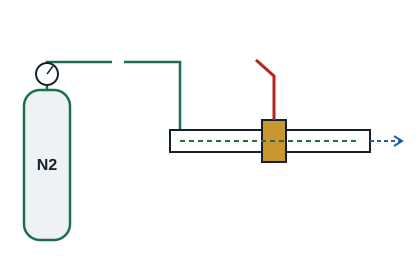

## General points

Brazing under nitrogen changes nothing in the joining technique itself, but it prevents scale forming inside the tube by introducing an inert gas, generally nitrogen.

Nitrogen enters at one end of the tube while the other end stays open: a trickle of nitrogen is enough to drive out the oxygen in the pipe, so preventing scale. This is a low-flow purge, about 6 l/min, not a pressurisation.

Scale harms certain components such as mechanical and electronic expansion valves. This method is recommended for pipework on variable refrigerant flow systems.

**Precaution**: nitrogen, oxygen and acetylene cylinders must be handled with care because of their internal pressure (sometimes up to 230 bar). Chain cylinders to a post or to a support firmly fixed to the floor, out of the sun.

## Procedure

1. Prepare and assemble the parts to be brazed.
2. Provide a nitrogen inlet and outlet on the assembly.
3. Connect the hose from the nitrogen cylinder, fitted with a regulator (manodétendeur), to the inlet on the assembly.
4. Set the regulator to a low pressure, between 0.2 and 0.5 bar, to obtain the planned flow.
5. Pass nitrogen through the pipework before any heating, long enough to drive out the air.
6. Open and set the acetylene regulator (between 0.2 and 0.5 bar).
7. Open and set the oxygen regulator (between 0.5 and 1.5 bar).
8. Light the torch and adjust the flame.
9. Braze.
10. Keep up the oxygen-free nitrogen purge while the joint cools.

[[figure:brasage-azote]]
