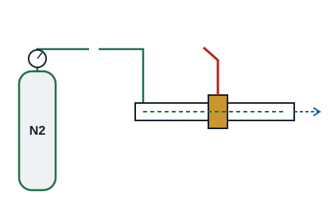

## Généralités

Le brasage sous azote ne change rien à la technique de la soudure, qui reste identique, mais cette pratique évite que la calamine se forme à l'intérieur du tube en introduisant un gaz inerte, généralement de l'azote.

L'azote est introduit d'un côté du tube tandis que l'autre côté reste ouvert : il suffit d'un filet d'azote pour que l'oxygène du tuyau à souder soit chassé, empêchant ainsi la calamine de se former. Il s'agit d'un balayage à faible débit, environ 6 l/min, et non d'une mise en pression.

La calamine est préjudiciable au bon fonctionnement de certains éléments comme les détendeurs mécaniques et électroniques. Cette mise en œuvre est recommandée pour les tuyauteries des systèmes à débit de réfrigérant variable.

**Précaution** : les bouteilles d'azote, d'oxygène et d'acétylène sont à manier avec prudence du fait de leur pression interne (allant parfois jusqu'à 230 bar). Bien enchaîner les bouteilles sur un poteau ou sur un support solidement fixé au sol, et à l'abri du soleil.

## Mode opératoire

1. Préparer et assembler les éléments à braser.
2. Disposer d'une voie d'entrée et de sortie de l'azote sur la maquette à braser.
3. Connecter le flexible de la bouteille d'azote, équipée d'un manodétendeur, à l'entrée prévue sur la maquette.
4. Régler le manodétendeur à basse pression, entre 0,2 et 0,5 bar, pour obtenir le débit prévu.
5. Faire passer l'azote dans la tuyauterie avant toute chauffe, le temps de chasser l'air.
6. Ouvrir et régler le manodétendeur de l'acétylène (entre 0,2 et 0,5 bar).
7. Ouvrir et régler le manodétendeur de l'oxygène (entre 0,5 et 1,5 bar).
8. Allumer le chalumeau et régler la flamme.
9. Braser.
10. Maintenir le balayage d'azote pendant le refroidissement du joint.

[[figure:brasage-azote]]
