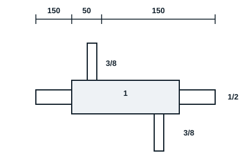

## Equipment and tools (per workstation)

For the group: 5 flaring tools, 5 swaging tools, 5 deburrers, 5 tube cutters, 3 drills and bits, small grinding wheels, 5 tape measures, 5 markers.

| Consumable | Quantity |
|---|---|
| Charging fittings | 20 |
| Nitrogen | 1 cylinder with regulator |
| 1" pipe | 4.5 metres |
| 1/2" pipe | 11 metres |
| 3/8" pipe | 7 metres |
| Filler rods | About 20 |
| Adhesive tape | 1 |
| Nut for 3/8 inch | 20 |
| Hose | 2 |

Also: oxy-acetylene set, tinted goggles, gloves, extinguisher.

## Sequence of work (6 h)

1. Trainer demonstrates the nitrogen purge.
2. Cut, deburr and assemble the exchanger model (1" shell, 1/2" inner tube, 3/8" branches).
3. Connect nitrogen to the inlet and leave the outlet open.
4. Start the purge, then braze while keeping up the flow.
5. Let cool under nitrogen.
6. Cut a test joint and check there is no scale.
7. Assessment.

## Assessment

- Accuracy of position and soundness of joints: 15%
- Operation (clean joints, no scale): 60%
- Standards, choice of equipment and safety: 10%
- Work report: 15%
