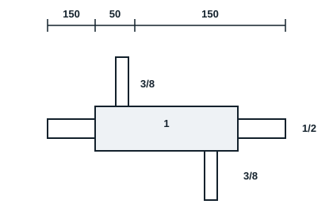

## Matériel et outillage nécessaires (par poste de travail)

Pour le groupe : 05 dudgeonnières, 05 pinces à emboutir, 05 ébavureurs, 05 coupe-tubes, 03 perceuses et mèches, petites meules, 05 mètres, 05 marqueurs.

| Consommable | Quantité |
|---|---|
| Raccords de charge | 20 |
| Azote | 1 bouteille avec manodétendeur |
| Tuyauterie 1" | 4,5 mètres |
| Tuyauterie 1/2" | 11 mètres |
| Tuyauterie 3/8" | 7 mètres |
| Brasures | Environ 20 |
| Ruban adhésif | 1 |
| Écrou pour 3/8 de pouce | 20 |
| Flexible | 2 |

Également : poste oxyacétylénique, lunettes teintées, gants, extincteur.

## Séquence de réalisation (6 h)

1. Démonstration du balayage d'azote par le formateur.
2. Couper, ébavurer et assembler la maquette d'échangeur (enveloppe 1", tube intérieur 1/2", piquages 3/8").
3. Raccorder l'azote sur l'entrée et laisser la sortie ouverte.
4. Lancer le balayage, puis braser en maintenant le débit.
5. Laisser refroidir sous azote.
6. Couper un joint témoin et contrôler l'absence de calamine.
7. Évaluation.

## Évaluation

- Exactitude dans la position et solidité des assemblages : 15 %
- Opérationnalité (joints propres, sans calamine) : 60 %
- Respect des normes, choix du matériel et sécurité : 10 %
- Compte rendu de manipulation : 15 %
