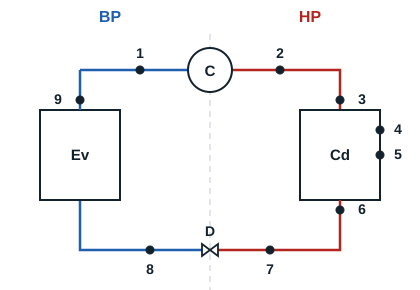

A basic refrigeration circuit is a set of four essential components with which a system produces cold in a closed circuit.

There are several other ways of producing cold: expansion of a compressed gas, thermoelectric cooling (Peltier effect), sublimation of a solid (as with CO2), adiabatic demagnetisation, dissolving certain salts... All these aim to preserve perishable goods and extend their life. The method studied here is the vaporisation of a liquid in a closed circuit.

| Component | Description | Types |
|---|---|---|
| Compressor | First component of the circuit: it moves the refrigerant by mechanical energy | Piston, screw, vane... |
| Condenser (condenseur) | Second component, after the compressor. This is where heat is extracted from the refrigerant | Forced or natural convection |
| Expansion valve (détendeur) | Next component. It divides the circuit in two parts (HP and BP) | Thermostatic with internal or external equalisation, electronic, capillary |
| Evaporator (évaporateur) | Last component of the circuit. This is where cold is produced | Cassette, ceiling, wall, plate exchanger; forced or natural convection |

