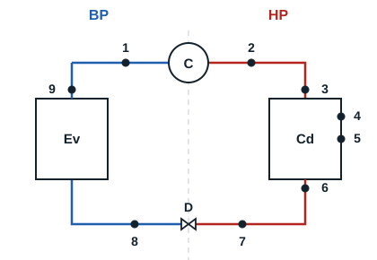

Un circuit frigorifique de base est un ensemble de quatre éléments essentiels dont dispose une installation pour produire le froid en circuit fermé.

Il existe plusieurs autres méthodes de production de froid : la détente d'un gaz comprimé, le refroidissement thermoélectrique (par effet Peltier), la sublimation d'un solide (cas du CO2), la désaimantation adiabatique, la dissolution de certains sels... Tous ces modes de production ont pour même but la conservation et la prolongation de la durée de vie des biens périssables. Le mode de production étudié ici est la vaporisation d'un liquide en circuit fermé.

| Élément | Description | Types |
|---|---|---|
| Compresseur | Premier élément du circuit : il met le fluide frigorigène en mouvement grâce à l'énergie mécanique | À piston, à vis, à palettes... |
| Condenseur | Second composant, suivant le compresseur. C'est le lieu où la chaleur du fluide frigorigène est extraite | À convection forcée ou naturelle |
| Détendeur | Composant suivant. Il divise le circuit en deux parties (HP et BP) | Thermostatique à égalisation de pression interne ou externe, électronique, capillaire |
| Évaporateur | Dernier composant du circuit. C'est le lieu où le froid est produit | En cassette, plafonnier, mural, échangeur à plaques ; à convection forcée ou naturelle |

