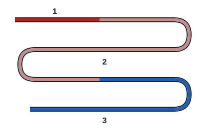
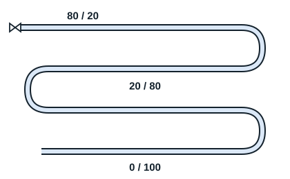

## The compressor

Using mechanical energy, it draws in gas at low pressure and low temperature, compresses it and discharges it at high pressure and high temperature. It draws low-pressure gas from the evaporator and discharges it to the condenser at high pressure.

## The condenser

Its role is to remove superheat from the hot vapour coming from the compressor, then condense it and subcool the refrigerant. During these stages, heat is taken from the refrigerant, which makes it liquefy.

## The expansion valve

Its role is to lower the pressure of the refrigerant to its evaporating pressure, which makes part of the fluid vaporise. This is the passage from high to low pressure, caused by flow through a small orifice.

## The evaporator

This heat exchanger absorbs energy from the medium to be cooled, through a liquid evaporating after expansion. The refrigerant thus absorbs heat from the air in the space, which cools down.

