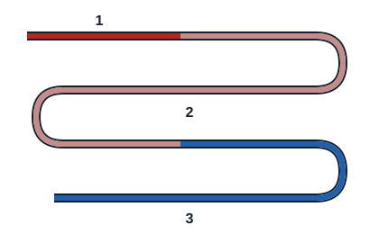
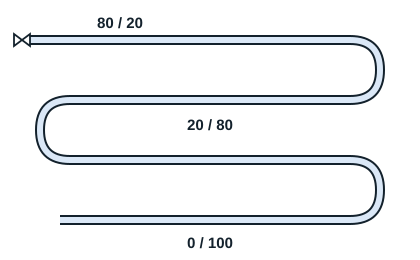

## Le compresseur

C'est un composant qui, grâce à l'énergie mécanique, aspire les gaz à basse pression et basse température, les comprime et les refoule à haute pression et haute température. Il aspire les gaz basse pression venant de l'évaporateur et les refoule vers le condenseur à haute pression.

## Le condenseur

Il a pour rôle de désurchauffer les vapeurs chaudes venant du compresseur, puis de les condenser et de sous-refroidir le fluide frigorigène. Durant ces étapes, la chaleur est retirée du fluide frigorigène, ce qui permet sa liquéfaction.

## Le détendeur

Il a pour rôle d'abaisser la pression du fluide frigorigène à sa pression d'évaporation, ce qui provoque une vaporisation partielle du fluide. C'est le passage de la haute pression à la basse pression, provoqué par le passage dans un orifice réduit.

## L'évaporateur

C'est un échangeur de chaleur qui a pour rôle d'absorber l'énergie provenant du milieu à refroidir, par le biais d'un liquide s'évaporant après avoir été détendu. Le fluide frigorigène absorbe ainsi la chaleur de l'air de l'enceinte, qui se refroidit.

