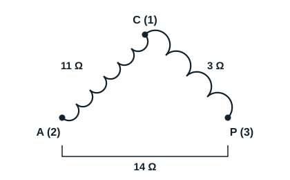

## General points

Motors set something in motion when supplied from a source. A motor has two main parts: the stator, which is fixed, and the rotor, which turns. The stator is used to find out whether an electric motor works, by identifying its windings. There are single-phase and three-phase motors.

## Operating principle

These motors drive most small compressors supplied at 230 V single-phase. They have two windings:

- **the main winding P** (run), in thick wire, designed to stay energised permanently and carry the rated current;
- **the auxiliary winding A** (start), in thinner wire, so with a higher resistance, which makes it easy to identify; it allows the motor to start.

If only the main winding of a motor is supplied, the motor hums and cannot start. Spun by hand it starts and keeps turning in the direction it was spun, which is hardly practical, especially on a hermetic shell. The auxiliary winding gives a starting torque greater than the load torque. A capacitor is usually connected in series with the auxiliary phase to give a phase shift close to 90° between the main and auxiliary currents: this second, artificial phase starts the motor.

## Terminals of a single-phase hermetic compressor

The three terminals are marked 1, 2 and 3. A thermal protector (protecteur thermique), on the common, protects the compressor against accidental overheating.

With the power off and all wires disconnected, the ohmmeter reads for example:

| Measurement | Resistance |
|---|---|
| Between 1 and 2 | 11 Ω |
| Between 1 and 3 | 3 Ω |
| Between 3 and 2 | 14 Ω |

Use a low range (for example 200 Ω), as these resistances are at most a few tens of ohms.

- The highest resistance is between 2 and 3: the third terminal, 1, is therefore the common C.
- The lowest resistance is between 1 and 3: this is the main winding P.
- So the auxiliary winding A is connected between 1 and 2.

Check: 11 + 3 = 14 Ω. Swapping main and auxiliary by mistake usually burns out the motor soon after it is energised: repeat the readings and draw a diagram with as much detail as possible.

[[figure:enroulements]]
