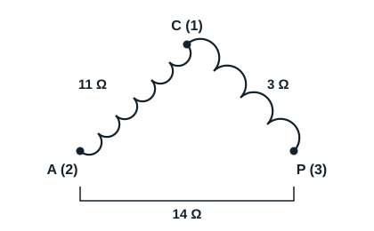

## Généralités

Les moteurs sont des dispositifs qui mettent un élément en mouvement lorsqu'ils sont alimentés par une source. Un moteur est constitué de deux grandes parties : le stator, partie fixe, et le rotor, partie mobile. C'est à partir du stator que l'on détermine si un moteur électrique est fonctionnel, en identifiant ses enroulements. Il existe des moteurs monophasés et des moteurs triphasés.

## Principe de fonctionnement

Ces moteurs équipent la plupart des petits compresseurs alimentés en monophasé 230 V. Ils sont constitués de deux enroulements :

- **l'enroulement principal P** (marche), en gros fil, prévu pour rester en permanence sous tension et supporter l'intensité nominale du moteur ;
- **l'enroulement auxiliaire A** (démarrage), en fil plus fin, donc plus résistant, ce qui permet de le repérer facilement ; il est prévu pour permettre le démarrage du moteur.

Si l'on alimente uniquement l'enroulement principal d'un moteur à vide, le moteur « grogne » et ne peut pas démarrer. Lancé à la main, il démarre et continue sa rotation dans le sens où on l'a lancé, ce qui n'est guère pratique, surtout sur une cloche hermétique. L'enroulement auxiliaire fournit un couple de démarrage supérieur au couple résistant de la machine entraînée. Un condensateur est généralement raccordé en série avec la phase auxiliaire, pour obtenir un déphasage proche de 90° entre le courant principal et le courant auxiliaire : c'est cette seconde phase artificielle qui permet le démarrage.

## Bornier d'un compresseur hermétique monophasé

Les trois bornes sont repérées 1, 2 et 3. Un protecteur thermique, monté sur le commun, protège le compresseur contre une surchauffe accidentelle.

Hors tension et tous les fils débranchés, l'ohmmètre indique par exemple :

| Mesure | Résistance |
|---|---|
| Entre 1 et 2 | 11 Ω |
| Entre 1 et 3 | 3 Ω |
| Entre 3 et 2 | 14 Ω |

Utiliser un petit calibre (par exemple 200 Ω), car ces résistances atteignent au plus quelques dizaines d'ohms.

- La résistance la plus forte se trouve entre 2 et 3 : la troisième borne, 1, est donc le commun C.
- La résistance la plus faible se trouve entre 1 et 3 : c'est l'enroulement principal P.
- C'est donc entre 1 et 2 qu'est raccordé l'enroulement auxiliaire A.

On vérifie : 11 + 3 = 14 Ω. Une permutation accidentelle entre la phase principale et l'auxiliaire se termine généralement par le grillage du moteur peu de temps après la mise sous tension : refaire les mesures et tracer un schéma portant le maximum d'indications.

[[figure:enroulements]]
