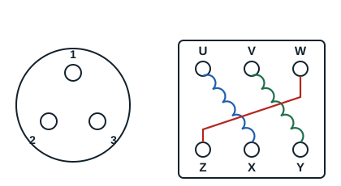

Three-phase motors have three identical windings, so three equal resistances: with this type of motor, mistakes are unlikely. Some motors bring out only 3 terminals and others 6 terminals, for 3 windings.

**Example on a 6-terminal motor**:

| Measurement | Resistance |
|---|---|
| Between U and X | 5 Ω |
| Between V and Y | 5 Ω |
| Between W and Z | 5 Ω |

The three windings are U-X, V-Y and W-Z. Between terminals of two different windings, the ohmmeter reads infinity once the connection links (barrettes) are removed.
