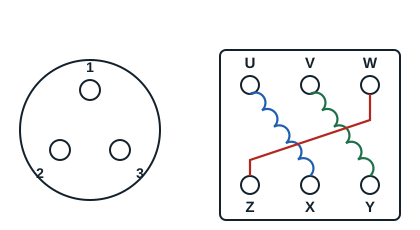

Les moteurs triphasés ont trois enroulements identiques, donc trois résistances égales : avec ce type de moteur, il est difficile de se tromper. Certains moteurs ne sortent que 3 bornes et d'autres sortent 6 bornes, pour 3 enroulements.

**Exemple d'identification sur un moteur à 6 bornes** :

| Mesure | Résistance |
|---|---|
| Entre U et X | 5 Ω |
| Entre V et Y | 5 Ω |
| Entre W et Z | 5 Ω |

Les trois enroulements sont U-X, V-Y et W-Z. Entre deux bornes de deux enroulements différents, l'ohmmètre indique l'infini, une fois les barrettes de couplage retirées.
